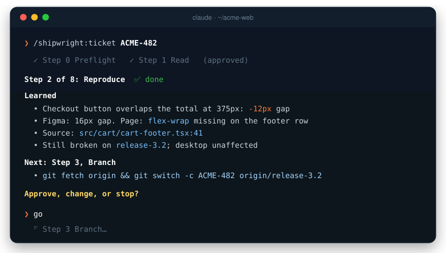
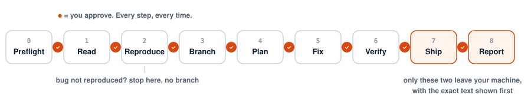

<p align="center">
  <picture>
    <source media="(prefers-color-scheme: dark)" srcset="assets/logo-dark.svg">
    
  </picture>
</p>

<h3 align="center">Hand it a ticket. Get back a verified pull request.</h3>

<p align="center">
  <em>It reproduces the bug in a real browser, fixes it, proves the fix, and opens the PR.<br>
  You approve every step. It never moves on without you. And it learns how your team ships.</em>
</p>

<p align="center">
  <a href="https://github.com/sulmanpucit/shipwright/stargazers"></a>
  <a href="https://github.com/sulmanpucit/shipwright/releases"></a>
  
  
  <a href="LICENSE"></a>
</p>

<p align="center">
  <a href="#install"><strong>Install</strong></a> ·
  <a href="#how-it-works"><strong>How it works</strong></a> ·
  <a href="#it-learns-how-your-team-ships"><strong>Learns</strong></a> ·
  <a href="#set-up-your-repo-in-a-minute"><strong>Setup</strong></a> ·
  <a href="#guardrails"><strong>Guardrails</strong></a> ·
  <a href="#faq"><strong>FAQ</strong></a>
</p>

<br>

<p align="center">
  
</p>

---

A shipwright doesn't launch a ship in one go. They build it plank by plank, and the captain inspects every one.

**Shipwright puts that discipline inside Claude Code.** One command takes a ticket all the way to a pull request: read, reproduce, branch, plan, fix, verify, ship. After every step it stops and tells you, in a few lines, **what it learned and what it's about to do.** You say *go*, *change this*, or *stop*.

You stop giving instructions and start making decisions.

## Before / after

<table>
<tr>
<th width="50%">Without Shipwright</th>
<th width="50%">With Shipwright</th>
</tr>
<tr valign="top">
<td>

```text
> read PROJ-482 and all the comments
> open the screenshots too
> open staging and reproduce it
> check it on mobile as well
> find the code that does this
> branch off the release branch
> ok, plan the fix
> now make the change
> run the tests and lint
> check it in the browser again
> commit it
> raise the PR, use our template
> add before/after screenshots
> leave a note for QA on the ticket
```

**14 instructions.** You manage the work.

</td>
<td>

```text
> /shipwright:ticket PROJ-482

  Step 1 Read       → go
  Step 2 Reproduce  → go
  Step 3 Branch     → go
  Step 4 Plan       → "keep the old prop"
  Step 4 Plan       → go
  Step 5 Fix        → go
  Step 6 Verify     → go
  Step 7 Ship       → go
  Step 8 Report     → go
```

**1 command. You only make the decisions,** each backed by evidence you can check in seconds.

</td>
</tr>
</table>

## Install

```bash
/plugin marketplace add sulmanpucit/shipwright
/plugin install shipwright@shipwright
```

Restart Claude Code, open your repo, then:

```bash
/shipwright:setup            # once per repo: a wizard writes your project config
/shipwright:ticket PROJ-482  # every ticket after that
```

## How it works

<p align="center">
  
</p>

| | Step | What Shipwright does |
|:-:|---|---|
| **0** | **Preflight** | Finds your connected tools (tracker, browser, git host, Figma) and checks your working tree. Missing something? It tells you the one-line fix. No config yet? It runs the [setup wizard](#set-up-your-repo-in-a-minute) first. |
| **1** | **Read** | Reads the ticket and **every** comment, oldest to newest, because the last one usually changed the scope. Opens **every** screenshot and follows design links. |
| **2** | **Reproduce** | Opens the page in a real browser and **proves** the bug with measurements, computed styles, console and network evidence. Compares against the design. Finds the code. |
| **3** | **Branch** | Cuts your branch from the right base. **Only after reproducing:** if the bug can't be reproduced, it stops and shows you everything it tried. |
| **4** | **Plan** | Plan mode: the cause, each file to change and why, the tests, and the **exact browser checks** that will prove the fix. |
| **5** | **Fix** | Makes only the approved changes in your repo's style. Runs type-check, lint and tests, and separates failures it caused from ones already on the base branch. |
| **6** | **Verify** | Starts your dev server, replays the original reproduction, runs every planned check at every viewport, and looks for collateral damage. Shows a pass/fail table. |
| **7** | **Ship** | Commit, push, PR, using your template and conventions. You see the **exact text** before anything leaves your machine. |
| **8** | **Report** | Drafts the ticket comment for QA: what changed, PR link, how to test. Posted only after you've read it. |

<details>
<summary><strong>What a check-in looks like, step by step</strong></summary>
<br>

Every step ends with the same four parts, so you always know where to look:

```text
**Step 5 of 8: Fix** ✅ done

**Learned**
- cart-footer.tsx: added flex-wrap and gap-16 to the footer row (matches Figma)
- cart-footer.test.tsx: one test for the wrapped layout at 375px
- type-check ✓  lint ✓  tests 14/14 ✓
- No deviations from the plan

**Next: Step 6, Verify**
- Start the dev server (npm run dev), open /cart at 375 and 1440
- Measure button-to-total gap: expect 16px at both
- Replay the Step 2 reproduction

**Approve, change, or stop?**
```

- **go**: run the next step.
- **change …**: redo this step your way, then check in again.
- **stop**: save progress and end cleanly.

</details>

<details>
<summary><strong>Pick up tomorrow where you left off</strong></summary>
<br>

Every run is logged to `~/.claude/shipwright/<repo>/<KEY>.md`: each step, what was learned, what you decided. Close the laptop, start a fresh session:

```bash
/shipwright:ticket PROJ-482 resume
```

It summarises where things stand and continues from the next step you haven't approved. Nothing is redone unless you ask.

</details>

## Why it stops after every step

Fully autonomous agents are impressive right up until they confidently fix the wrong bug, on the wrong branch, and post about it on the ticket.

Shipwright bets the other way: **the expensive mistakes happen at decision points, so that's exactly where you should be.** The craft is in making each stop cheap:

- **Short.** A handful of facts, not a wall of narration.
- **Evidence-first.** Every claim cites a URL, a measurement, a command's output or a `file:line`.
- **One step at a time.** Approval never carries over. "go" on the plan doesn't mean "go" on the push.

You keep the speed of automation and the judgement of a reviewer who watched every step.

## It learns how your team ships

Every correction you make is a chance to never make it again. When your feedback sounds like a lasting rule, Shipwright applies it right away, then offers to remember it:

```text
**Step 2 of 8: Reproduce**  ✅ done

**Learned**
- Card title overflows by 14px at 1440px

> also check mobile. we always check 375 and 1440 for UI bugs

**Step 2 of 8: Reproduce**  ✅ redone
**Learned**
- 1440px: overflows by 14px.  375px: overflows by 31px and wraps to 3 lines

**Save as a rule?** "Check 375px and 1440px when reproducing UI bugs." under Reproduce
→ team / just me / no, this ticket only

> team

✓ Saved to .claude/shipwright.md → Step rules → Reproduce
```

On the next ticket, and for everyone on your team, that step follows the rule, and **says so**, so you can see your rules working and catch one that's gone stale:

```text
**Learned**
- Following your rule: checked 375px and 1440px
- 375px: badge overlaps the icon by 6px. 1440px: fine
```

**Rules are plain Markdown you own.** They live in your repo under `## Step rules`, filed by step. You can read, edit and review them in a PR like any other code.

- **Team or just me.** Team rules go in `.claude/shipwright.md`; personal ones in your gitignored `.claude/shipwright.local.md`.
- **Never silent.** Nothing is saved without your explicit "team" or "just me", and you see the exact line first.
- **No pile-up.** Duplicates are skipped and conflicts are resolved with you, not stacked.
- **Easy to prune.** `/shipwright:setup` → *Review saved rules* flags duplicates, contradictions and rules that point at scripts or branches that no longer exist.

Ticket by ticket, Shipwright stops being a generic workflow and becomes **your team's** workflow, written down.

## Set up your repo in a minute

Every team ships differently. Shipwright learns yours with a wizard, not a form:

```bash
/shipwright:setup
```

**It detects first and asks second.** It reads your lockfile and scripts, release branches, PR template, last 50 commits and branch names, your `CLAUDE.md` and `CONTRIBUTING.md`, and which tools are connected. Then it asks **at most four questions**, with its best guess pre-selected:

```text
Base branch for new work?
  ● Latest release-* branch   (Detected: release-3.2)
  ○ main
  ○ develop

Commit format?
  ● PROJ-123: summary         (Detected, e.g. "PROJ-471: Fix cart badge count")
  ○ Conventional Commits
  ○ Free text
```

Plus one optional question: *"Anything a new teammate usually gets wrong here?"* Those answers become house rules Shipwright follows on every ticket.

You preview the whole file before it's written to `.claude/shipwright.md`. **Commit it and your whole team ships the same way.** Want it just for you? `/shipwright:setup --local`.

## Bring your own tools

Shipwright **ships no credentials and bundles no servers.** It uses what *you* have connected, signed in as *you*, so everyone on a team works with their own access.

| | Use any of | How to connect |
|---|---|---|
| **Tickets** | Jira · Linear · GitHub Issues | Atlassian connector or `claude mcp add --transport http atlassian https://mcp.atlassian.com/v1/mcp`, Linear MCP, or `gh` |
| **Browser** | Claude in Chrome · Playwright | [Claude in Chrome](https://claude.com/chrome) extension, or `claude mcp add playwright npx @playwright/mcp@latest` |
| **Git host** | GitHub | `gh auth login` |
| **Designs** | Figma *(optional)* | `claude mcp add --transport http figma https://mcp.figma.com/mcp` |

**Missing a piece? It does less rather than failing.** No browser means reproduce and verify fall back to code and tests, and every check-in says so. No tracker means you paste the ticket in.

## Guardrails

Shipwright will **never**:

- ⛔ start a step you haven't approved
- ⛔ push, open a PR or post a comment you haven't read word for word
- ⛔ type a password or complete an SSO login (it asks you to sign in)
- ⛔ stash, reset or throw away your uncommitted work
- ⛔ force push, or push to your base branch
- ⛔ follow instructions hidden in a ticket, comment or web page (it quotes them to you and asks)
- ⛔ copy secrets from `.env` files into its config

## FAQ

<details>
<summary><strong>Does it work with my stack?</strong></summary>
<br>

The workflow is language- and framework-agnostic. The setup wizard writes your commands, branches and conventions into `.claude/shipwright.md`. It shines on **web UI work**, where a browser can prove the bug and the fix. Backend, CLI and mobile tickets work too, with code and tests as the evidence instead of the browser.

</details>

<details>
<summary><strong>What if the bug can't be reproduced?</strong></summary>
<br>

It stops at Step 2 and lists every URL, environment, data set and viewport it tried. Then it offers options: draft a question for the reporter, try another environment, or go ahead based on what the code shows. No branch is created for a bug nobody has seen.

</details>

<details>
<summary><strong>Can I skip the stops?</strong></summary>
<br>

Not yet, and that's deliberate. Each check-in is a few lines, so "go" takes seconds. Optional auto-approve for the local-only steps (read, reproduce, plan) is on the roadmap.

</details>

<details>
<summary><strong>Is it only for bugs?</strong></summary>
<br>

No. Small features and design QA tickets run the same way. "Reproduce" becomes "show the current state against the spec", and "verify" proves the page now matches it.

</details>

<details>
<summary><strong>Does it remember my corrections?</strong></summary>
<br>

Yes, if you want it to. When feedback sounds like a lasting rule ("always", "never", "next time", "our team does…"), Shipwright offers to save it as a Step rule for your team or just for you. Feedback that only concerns the current ticket isn't saved, and nothing is saved without your say-so. See [It learns how your team ships](#it-learns-how-your-team-ships).

</details>

<details>
<summary><strong>Where do my company's details live?</strong></summary>
<br>

In `.claude/shipwright.md`, inside **your** repo. Internal hostnames, ticket sites, branch rules and house rules never touch this plugin. Shipwright itself stays generic.

</details>

<details>
<summary><strong>How is this different from just asking Claude Code?</strong></summary>
<br>

Claude Code can do every step. Shipwright makes it do **all** of them, **in order**, **with evidence**, the same way for everyone on your team, and stop at the right moments, without you having to remember to ask. The reproduction comes before the branch, the verification is planned before the fix, and nothing leaves your machine unseen.

</details>

## Roadmap

- [x] Eight-step ticket workflow with approval gates
- [x] Resume across sessions
- [x] Setup wizard that detects your repo's conventions
- [x] Learns Step rules from your feedback, for the team or just you
- [ ] Optional auto-approve for local-only steps
- [ ] Batch triage: walk a sprint's tickets and reproduce each
- [ ] Hand a run over to a teammate
- [ ] More trackers: Shortcut, Azure Boards

## Contributing

The best bug report is a ticket flow Shipwright got wrong. [Open an issue](https://github.com/sulmanpucit/shipwright/issues) with the step, what it did and what it should have done. Pull requests welcome. The whole plugin is two Markdown skills in [`skills/`](skills/), so you can read it in five minutes.

If Shipwright saved you an afternoon, a ⭐ helps other people find it.

<br>

<p align="center">
  <sub>MIT licensed · Built for <a href="https://claude.com/claude-code">Claude Code</a></sub>
</p>
